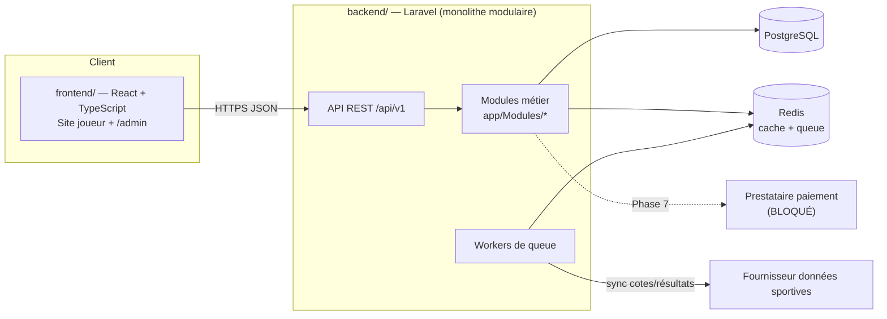
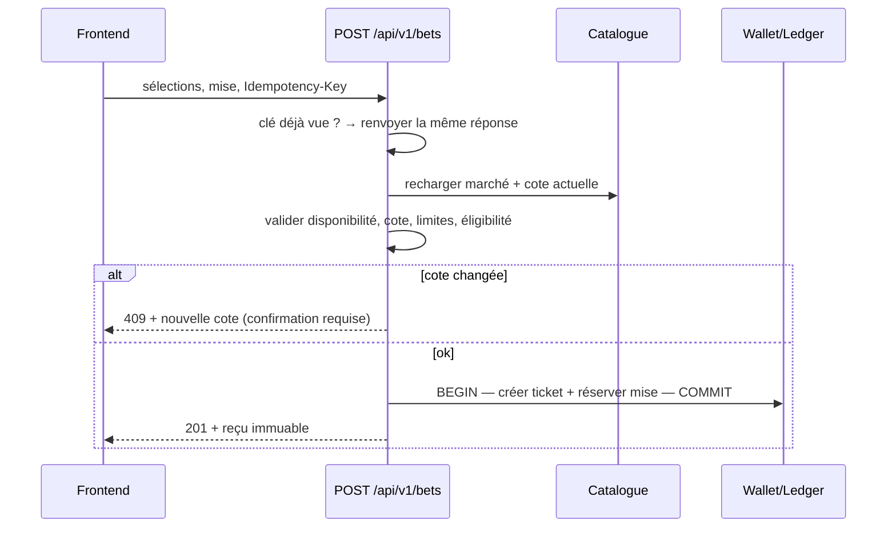

# Architecture — REYEL 16 PAYAJ V1

Résumé opérationnel du document de référence
[`architecture/REYEL_16_PAYAJ_Architecture_Technique_Plan_Developpement_Sportif.docx`](architecture/).
En cas de doute, le document de référence fait foi.

## Périmètre V1

**Inclus :** site public responsive (sports, matchs, marchés, cotes), compte joueur, coupon de pari,
historique des tickets, portefeuille transactionnel (simulé), panneau d'administration, connecteur
fournisseur de données sportives, environnements Dev/Staging/Prod.

**Exclu par défaut :** application mobile native, casino/loto/borlette/courses/streaming/paris en direct,
**paiements réels, retraits et paris réels** (bloqués jusqu'à validation juridique, contractuelle et fournisseur).

## Vue d'ensemble

## Couches

| Couche | Techno | Dossier |
|---|---|---|
| Frontend web | React 19 + TypeScript + Vite + React Router | `frontend/` |
| Backend/API | Laravel 13 / PHP 8.3, Sanctum | `backend/` |
| Base de données | PostgreSQL 16 | `docker-compose.yml` |
| Cache / tâches | Redis 7 + Laravel Queue | `docker-compose.yml` |

## Modules backend

Chaque module vit dans `backend/app/Modules/<Module>/` avec son `README.md` (responsabilités, tables, routes, règles).

| Module | Dossier | Phase |
|---|---|---|
| Identity & Access | `IdentityAccess` | 2 |
| Sports Data Adapter | `SportsData` | 3 |
| Betting Catalogue | `Catalogue` | 3 |
| Bet Slip & Tickets | `Betting` | 4 |
| Wallet & Ledger | `Wallet` | 5 |
| Settlement | `Settlement` | 5 |
| Admin & Operations | `Admin` | 6 |
| Audit & Reporting | `Audit` | 6 |
| Compliance & Responsible Play | `Compliance` | 7 |
| Payments Adapter | `Payments` | 7 (bloqué) |

**Règle de dépendance :** un module appelle un autre module via ses `Services`, jamais en écrivant
directement dans ses tables. Pas de dépendance circulaire.

## Règles non négociables

1. Toute opération financière et toute validation de ticket est décidée **côté serveur**.
2. Transactions SQL + **clé d'idempotence** sur toute opération à effet (`Idempotency-Key`).
3. Montants en **entier (unité mineure)** via `App\Support\Money` — jamais de `float`.
4. Ledger **append-only** : corrections par écritures compensatoires.
5. Cote acceptée et version des règles **figées** sur le ticket.
6. Secrets uniquement dans `.env` / gestionnaire de secrets — jamais dans le code ni le frontend.
7. RBAC appliqué sur l'API ; MFA pour les rôles admin sensibles ; actions sensibles auditées.
8. Contrats API documentés dans [`api/openapi.yaml`](api/openapi.yaml) avant intégration frontend.

## Flux critiques

### Acceptation d'un pari (§4.2)

### Règlement (§4.3)

Résultat d'une source autorisée → stocké avec source/version → statut du ticket calculé avec la cote figée
→ écriture ledger idempotente → correction éventuelle par processus audité.

## Environnements

| Env | Usage | Règles |
|---|---|---|
| Development | Docker local | Données et fonds fictifs |
| Staging | Recette, sandbox fournisseur, E2E | Aucun fonds réel |
| Production | Public, après autorisation | Accès minimal, sauvegardes, monitoring, rollback |
